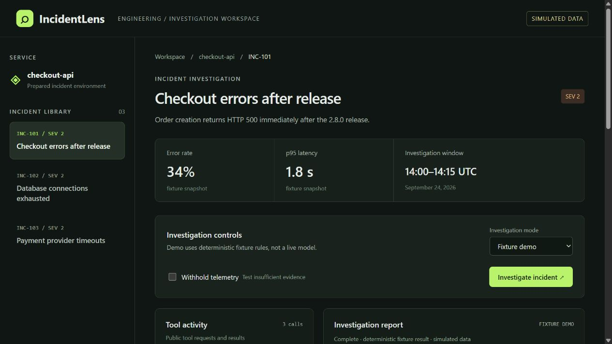
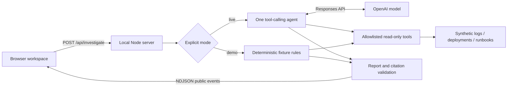

# IncidentLens

[](https://github.com/BhavyaPatel0306/incidentlens/actions/workflows/ci.yml)

**JavaScript · Node.js · OpenAI Responses API · Tool-calling agent**

An incident investigation workspace where an AI agent inspects logs, deployment history, and runbooks, then produces a likely-cause report in which every claim cites a source record. All tools are read-only, and reports with missing or unknown citations are rejected before they reach the user.



> Runs against three simulated incidents for a checkout service. The default demo mode is deterministic and works offline; Live AI mode connects to OpenAI with your own key.

## Highlights

- **Grounded reports:** the server validates every citation against retrieved records and rejects any report that names a cause without supporting logs.
- **Safe tool use:** three allowlisted, read-only tools with argument validation, incident scoping, and immutable results.
- **Bounded agent loop:** at most seven model requests and nine tool calls per investigation, with a 45-second timeout per request.
- **Knows when to say "I don't know":** when telemetry is withheld, the agent reports *insufficient evidence* instead of guessing.
- **Secure local server:** API key stays server-side, same-origin and host checks, 2 KB request limit, and model output rendered as text, never HTML.
- **Zero runtime dependencies**, with CI running tests and a scripted evaluation on every push.

## Run locally

Requires Node.js 22.9 or later. No install step is needed.

```sh
npm start
```

Open http://127.0.0.1:4317 (override with `PORT`).

**Live AI (optional):** copy `.env.example` to `.env`, set `OPENAI_API_KEY` and `OPENAI_MODEL`, restart, and select **Live AI** in the interface. Live mode sends the synthetic incident data to OpenAI and uses paid API calls.

## Two-minute demo

1. Select **Checkout errors after release** and click **Investigate incident**.
2. Expand the three tool calls to see their arguments. The report traces the failure to a skipped schema migration.
3. Click **L102** in the report to highlight its source record, then compare it with **D101**.
4. Investigate **Database connections exhausted**: idle export transactions explain the pool exhaustion.
5. Investigate **Payment provider timeouts**: local probes are healthy while dependency probes fail.
6. Check **Withhold telemetry** and investigate again: with only runbooks available, the report says **insufficient evidence**.

## Architecture



| Path | Responsibility |
| --- | --- |
| `server.mjs` | HTTP API, static-asset allowlist, request limits, one investigation at a time |
| `src/agent.mjs` | Agent loop, provider transport, demo rules, report validation |
| `src/tools.mjs` | Tool schemas, argument validation, incident scoping |
| `src/fixtures.mjs` | Three incident datasets and runbooks with stable record IDs |
| `public/` | Responsive, dependency-free UI |
| `test/` | Tool, orchestration (mocked provider), safety, and HTTP integration tests |
| `scripts/evaluate.mjs` | Four-case evaluation with separate demo and live results |

The tool-calling flow follows the [OpenAI function-calling guide](https://developers.openai.com/api/docs/guides/function-calling): tool call IDs are preserved and outputs are passed back into the conversation. Provider reasoning stays server-side; only tool requests, results, validated reports, and status events reach the browser.

## Testing

```sh
npm test          # 10 unit and integration tests
npm run eval      # 4 scripted investigations
npm run eval:live # optional, requires an API key
```

All 10 tests and all 4 demo evaluations (migration mismatch, connection leak, payment dependency timeout, missing telemetry) pass in CI. Results are saved to [eval/demo-results.json](eval/demo-results.json). The demo evaluation is a regression check on the fixture rules, not a benchmark of model quality.

## Future work

- Run and publish the live-model evaluation.
- Ingest real log streams instead of static fixtures.
- Check that cited records actually support each claim, not just that they were retrieved.
