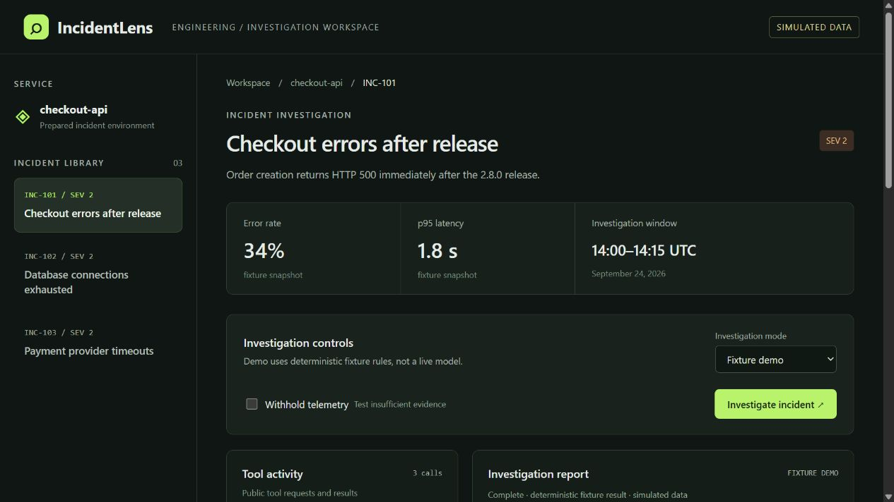
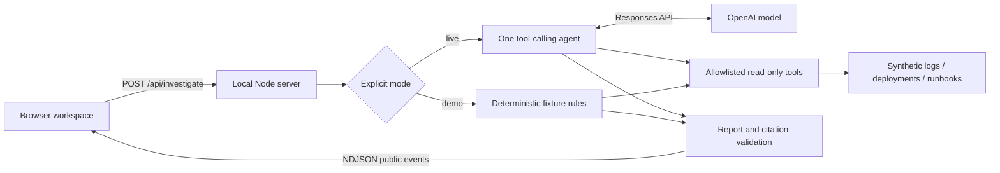

# IncidentLens

An evidence-first incident investigation workspace for one simulated checkout service. A single AI agent can inspect logs, check deployment history, and read runbooks before producing a cited likely-cause report. Every tool is read-only. No infrastructure changes or automatic remediation exist.

**All telemetry is simulated.** The default fixture demo is deterministic and works offline without an API key. Live AI is a separate, explicitly selected mode; it has not been validated against a real model in this delivery.



[](https://github.com/BhavyaPatel0306/incidentlens/actions/workflows/ci.yml)

## Run locally

Requires Node.js 22.9+ (tested with 24.14.0). No third-party runtime packages or installation step are required.

```sh
npm start
```

Open http://127.0.0.1:4317. Stop with Ctrl+C. The server binds only to the local machine. Override `PORT` if needed.

For live AI, copy `.env.example` to `.env`, set `OPENAI_API_KEY` and a Responses-compatible `OPENAI_MODEL` available to your account, then restart. Select **Live AI** in the interface. The example model is `gpt-5-mini`; availability depends on your account. Never put a key in browser code or commit `.env`. Live mode sends the selected synthetic incident and retrieved synthetic records to OpenAI and may incur API charges. Missing credentials disable the live selector; API errors never silently fall back to demo results.

## A two-minute demo

1. Select **Checkout errors after release**, keep **Fixture demo**, and click **Investigate incident**.
2. Inspect the three tool calls. Expand a call to see arguments and coverage. The report attributes the failure to a skipped schema migration.
3. Click **L102** in the report. Its source record highlights in the evidence explorer; compare it with **D101**.
4. Select **Database connections exhausted** and investigate: idle export transactions explain pool exhaustion.
5. Select **Payment provider timeouts** and investigate: local probes are healthy while dependency probes fail. The report acknowledges that provider and network failures cannot be distinguished.
6. Check **Withhold telemetry** and investigate again. Logs and deployment records are unavailable; runbooks alone cannot justify a cause. The report says **insufficient evidence**.

## Architecture



- `src/fixtures.mjs`: three prepared incident datasets and runbook records with stable IDs.
- `src/tools.mjs`: three tool schemas, substring filtering, argument validation, immutable result copies, and incident scoping enforced by server context.
- `src/agent.mjs`: bounded agent loop, provider transport, demo rules, structured report validation. Live mode chooses tool order and filters; it does not consume the demo answer templates or evaluation ground truth.
- `server.mjs`: local HTTP API, static-asset allowlist, same-origin/host checks, 2 KB request limit, and one investigation at a time.
- `public/`: responsive dependency-free UI. Browser rendering uses text nodes, not model-generated HTML.
- `test/`: deterministic tools, orchestration with a mocked provider, safety boundaries, and real HTTP integration.
- `scripts/evaluate.mjs`: four-case heuristic evaluation, with separate demo and live result files.

The server keeps the API key private. Only public tool requests, tool results, validated reports, and status events reach the browser. Provider reasoning items remain inside the server-side conversation. Each investigation has at most seven model requests and nine attempted tool calls; each provider request times out after 45 seconds. Invalid calls return a safe error to the model. Reports with unknown citations, missing required fields, or a likely cause without cited logs are rejected.

The implementation follows the [OpenAI function-calling guide](https://developers.openai.com/api/docs/guides/function-calling). It preserves tool call IDs and passes tool outputs back into the model conversation.

## Measured validation

Run these commands from this repository:

```sh
npm test
npm run eval
# Optional, requires server-side credentials and uses paid API calls:
npm run eval:live
```

Measured on September 24, 2026, using Node 24.14.0:

- **10/10 automated tests passed.** These test deterministic code and a mocked provider, not real model quality.
- **4/4 demo evaluations passed:** migration mismatch, connection leak, payment dependency timeout, and missing telemetry. Each made three tool calls. The machine-readable artifact is [eval/demo-results.json](eval/demo-results.json).
- Browser checks passed for all three incident reports, the missing-evidence flow, source-link navigation, and a 390-pixel mobile viewport with no horizontal document overflow. No browser errors or warnings were captured during the flows.
- **Live AI evaluation was not run:** no `OPENAI_API_KEY` was available. No live accuracy, latency, or cost claim is made.

Evaluation checks report status, expected cause keywords, required supporting citations, and citation membership. It is deliberately small and does not measure generalization, calibrated confidence, semantic entailment, or robustness to adversarial telemetry. The demo rules are hand-authored for these fixtures: their passing score is a regression check, not an AI benchmark. Review actual reports manually when running live evaluation.

## Limitations and design tradeoffs

This is a 1–2 day portfolio scope: one service, three static incidents, no ingestion pipeline, storage, authentication, production monitoring, or remediation. State resets on reload. Summary metrics are prepared snapshots, not calculations from raw logs. The third fixture's known fault is a payment dependency timeout; the available records intentionally leave its deeper provider-versus-network cause uncertain.

Citation validation proves a cited record was retrieved, not that it logically entails the model's claim. Live output may still be mistaken. Confidence labels are qualitative. The local server is not designed for public hosting or multiple users. A disconnected browser does not cancel a provider request already in progress; the request timeout and turn budget still bound it. Demo calls complete immediately, so the browser may display all three activity events together rather than progressively.

## Project status

Published as a portfolio demonstrator. [GitHub Actions](https://github.com/BhavyaPatel0306/incidentlens/actions) runs automated tests and the deterministic fixture evaluation without API credentials. The recorded results above distinguish demo regression checks from live-model evaluation.
